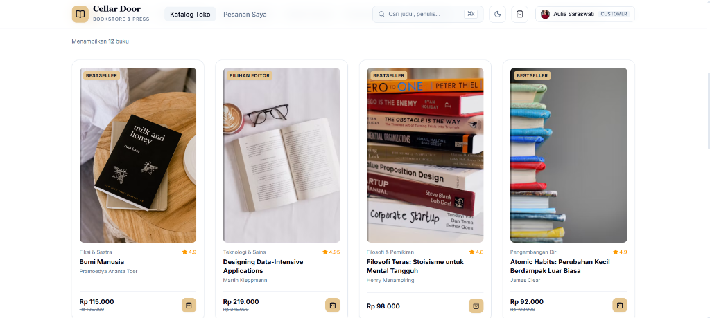
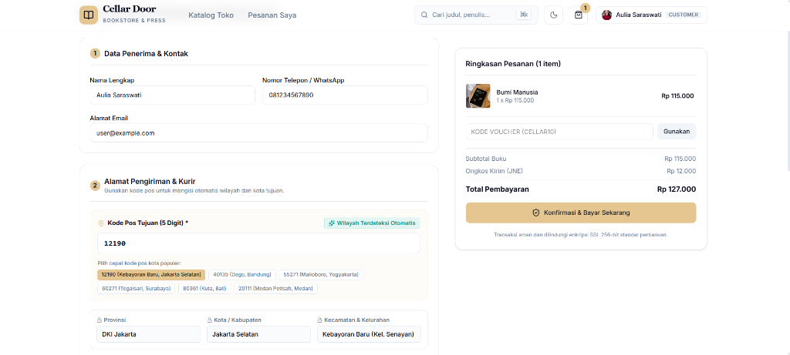

# Cellar Door Bookstore & Press 📚

Aplikasi toko buku modern dengan arsitektur dua sisi (*Dual-Sided: Public Storefront & Admin Backoffice*), dibangun menggunakan **React 19**, **Vite 6**, **Tailwind CSS v4**, dan sistem desain **[shadcn-admin-design-system](https://github.com/pranataa-labs/workflow-master)** beraksen emas hangat (*warm book gold* `#E5C690`).

---

## 📸 Tangkapan Layar Aplikasi (Screenshots)

### 1. Katalog Toko Publik (*Storefront Catalog*)
Tampilan katalog buku kurasi dengan kartu buku berdiskon, lencana kategori (*Bestseller*, *Pilihan Editor*), ulasan rating, serta tombol aksi beraksen `#E5C690`.



### 2. Alur Checkout Berbasis Kode Pos Otomatis (*Postal-Code-First Auto-Fill*)
Pengisian alamat pengiriman yang efisien di mana pembeli cukup memasukkan 5 digit kode pos di posisi teratas untuk mengisi otomatis Provinsi, Kota/Kabupaten, dan Kecamatan/Kelurahan.



---

## 🌟 Fitur Utama

### 🛒 Sisi Pelanggan (Customer Experience)
- **Hero Banner & Kurasi Pilihan**: Tajuk kontemplatif bertema literasi dan rekayasa perangkat lunak terpilih.
- **Katalog & Filter Kategori**: Filter kategori aktif (*Fiksi & Sastra*, *Teknologi & Sains*, *Filosofi*, *Bisnis & Finansial*, *Pengembangan Diri*, *Seni & Desain*) dengan pengurutan harga dan rating.
- **Pencarian Cerdas (⌘K / Ctrl+K)**: Command palette untuk mencari judul buku, penulis, topik, atau navigasi cepat.
- **Pratinjau Sampul Buku Aman (*BookCoverImage*)**: Tautan foto buku asli beresolusi tinggi dengan fallback otomatis ke sampul fisik hardcover bersampul embossed jika koneksi offline.
- **Slide-Over Keranjang Belanja**: Kontrol kuantitas dengan batas stok riil dan dukungan kode voucher aktif (`CELLAR10` diskon 10%, `LITERASI` diskon 15%).
- **Checkout Pintar (Kode Pos Paling Atas)**: Auto-fill wilayah pengiriman dari database kode pos Indonesia (`postalCodes.ts`).
- **Pilihan Kurir & Pembayaran**: Integrasi simulasi JNE, SiCepat, GoSend, serta metode pembayaran QRIS, Transfer VA, Kartu Kredit, dan COD.
- **Pelacakan Pesanan (*My Orders*)**: Riwayat transaksi lengkap dengan status alur kerja (*Pending*, *Diproses*, *Dikirim*, *Selesai*) dan nomor resi kurir.

### 🛡️ Sisi Pengelola (Admin Backoffice)
- **Desain Khusus satnaing/shadcn-admin**: Sidebar 16rem yang dapat diciutkan (*collapsible icon mode*), header lengket (*sticky blurred*), dan kartu KPI dengan tren omzet.
- **Dashboard Eksekutif**: 4 Kartu KPI (Total Pendapatan, Total Pesanan, Judul Aktif, Pelanggan Aktif) dan grafik visual omzet bulanan.
- **Katalog & Manajemen Stok (CRUD)**: Tabel data TanStack dengan indikator stok cerdas (*Tersedia*, *Menipis*, *Habis*) dan slide-out Sheet Drawer untuk tambah/edit data buku.
- **Manajemen Pesanan & Resi**: Pembaruan status pesanan langsung melalui dropdown yang menyinkronkan status pelacakan pembeli secara realtime.
- **Direktori Pelanggan & Analitik**: Daftar pembaca terdaftar, tier loyalitas, serta distribusi omzet per kategori buku.

---

## 🔑 Akun Demo Siap Pakai

Tersedia tombol **1-Klik Beralih Akun** pada header, jendela login, dan footer:

| Peran | Email | Kata Sandi | Akses Utama |
|---|---|---|---|
| **Admin** | `admin@example.com` | `password123` | Backoffice Dashboard, CRUD Buku, Manajemen Pesanan, Analitik |
| **Customer** | `user@example.com` | `password123` | Storefront, Keranjang Belanja, Checkout Multi-kurir, Pesanan Saya |

---

## 🎨 Palet Desain & Aksen Warna

- **Slate OKLCH**: Palet netral modern sesuai standar `shadcn-admin` yang tenang dan profesional.
- **Warm Book Gold (`#E5C690`)**: Digunakan sebagai aksen warna utama (*primary brand accent*) pada tombol ikon belanja, badge logo buku, tombol konfirmasi pembayaran, serta indikator keranjang belanja.
- **Tipografi**: Menggunakan font **Inter** untuk keterbacaan antarmuka yang optimal.

---

## 🛠️ Menjalankan Proyek Secara Lokal

### Prasyarat
- Node.js (v18 ke atas, direkomendasikan v20+)
- pnpm atau npm

### Langkah Instalasi
```bash
# 1. Masuk ke direktori proyek
cd cellar-door-bookstore

# 2. Pasang dependensi
pnpm install

# 3. Jalankan server pengembangan
pnpm run dev
```

Buka peramban di **[http://localhost:5173/](http://localhost:5173/)**.

### Menjalankan Pengujian (Testing)
```bash
# Menjalankan suite pengujian unit berbasis pola AAA (Arrange-Act-Assert)
pnpm test
```

### Build Produksi
```bash
pnpm run build
```

---

## 📋 Struktur Berkas Proyek

```
cellar-door-bookstore/
├── docs/
│   └── images/
│       ├── storefront-catalog.png        # Screenshot katalog toko
│       └── checkout-postal-autofill.png  # Screenshot checkout kode pos
├── src/
│   ├── components/
│   │   ├── admin/                        # Panel Admin Backoffice (Dashboard, Katalog, Pesanan, Pelanggan)
│   │   ├── cart/                         # Slide-over Keranjang & Kalkulasi Promo
│   │   ├── common/                       # Header, Footer, CommandPalette, BookCoverImage, AuthModal
│   │   └── store/                        # CatalogView, BookDetailModal, CheckoutView, OrderSuccessView
│   ├── context/
│   │   └── BookstoreContext.tsx          # Store Engine & Global State (LocalStorage v2)
│   ├── data/
│   │   ├── postalCodes.ts                # Database referensi Kode Pos Indonesia & Auto-fill
│   │   └── seedData.ts                   # 12 Buku kurasi & pesanan awal
│   ├── lib/
│   │   └── utils.ts                      # Helper format Rupiah & tailwind-merge (cn)
│   ├── tests/
│   │   └── bookstore.test.ts             # 12 Unit test (Harga, Stok, Kode Pos, Auth)
│   ├── types/
│   │   └── index.ts                      # Definisi tipe TypeScript
│   ├── App.tsx
│   ├── index.css                         # Token Slate OKLCH & #E5C690 Primary
│   └── main.tsx
├── package.json
├── tsconfig.json
└── vite.config.ts
```

---

## 📄 Lisensi
Dilisensikan di bawah [MIT License](LICENSE).
